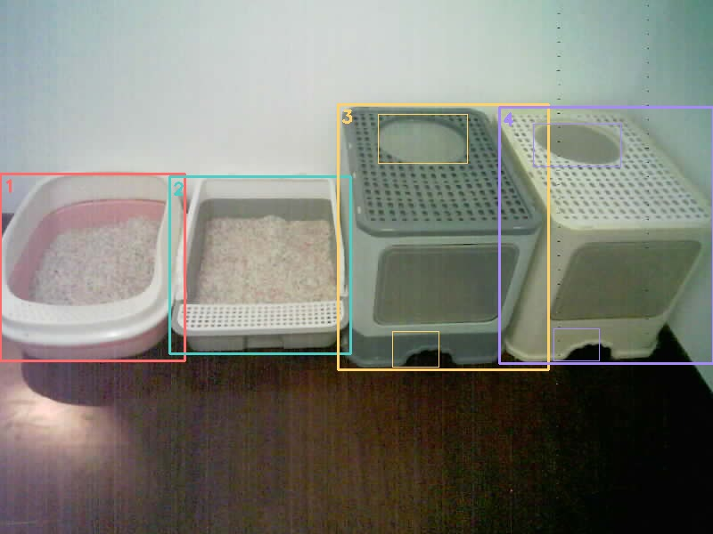

# Litterbox Vision

一个持续演进的 ESP32-S3 猫房监控开源项目。第一阶段面向四个猫砂盆，结合摄像头、两块 AMOLED 屏和电脑端视觉模型，展示四只猫每天的使用次数与偏好，并保存事件录像。



## 已实现功能

- **实时画面与声音**：OV5640 输出 800×600 JPEG，当前实机约 16 FPS；支持 MJPEG、UDP 图传、丢包修复和 16 kHz 单声道音频。
- **双屏分工**：
  - 1.75 寸屏：466×466 实时取景画面。
  - 2.16 寸屏：上半屏 480×240 LIVE，下半屏四猫头像、当天次数和偏好猫砂盆徽章。
- **四猫统计**：按自然日统计每只猫的使用次数和偏好盆；未知身份单独计数，不强行猜测。
- **开放盆与带盖盆**：分别使用行为状态机，处理进入、停留、顶部离开和连续无猫等情况。
- **事件录像**：保存 H.264 + AAC MP4，包含事前、事件过程和事后片段，支持音画检查。
- **防闪烁卡片**：2.16 只在统计内容变化时重绘，时间戳更新不会导致徽章周期性重载。
- **演示模式**：固定猫卡数据，独立循环视频仅供 2.16；1.75 继续显示真实画面，演示帧不进入真实事件或录像。
- **局域网 OTA**：摄像头支持双应用槽升级、启动自检和失败回滚。

> 视觉理解在电脑调用的云端 API 上运行，不在 ESP32 上直接运行大模型。整帧初筛和身份复核以 `MiniCPM-V-4.7-35B-A3B` 为主，模型名可通过环境变量配置。统计表示猫砂盆使用次数，不等同于严格排泄次数。

## 硬件

| 设备 | 用途 |
| --- | --- |
| [Waveshare ESP32-S3-CAM-OV5640](https://docs.waveshare.com/ESP32-S3-CAM-OVxxxx?variant=ESP32-S3-CAM-OV5640) | 摄像头与双麦音频采集 |
| [Waveshare ESP32-S3-Touch-AMOLED-1.75](https://docs.waveshare.com/ESP32-S3-Touch-AMOLED-1.75) | 摄像头旁的实时取景屏 |
| [Waveshare ESP32-S3-Touch-AMOLED-2.16](https://docs.waveshare.com/ESP32-S3-Touch-AMOLED-2.16) | LIVE 画面与四猫统计卡片 |
| 局域网常驻电脑 | 图传中继、视觉模型、状态机、SQLite、录像与演示视频解码 |

三块 ESP32 设备通过 2.4 GHz Wi-Fi 与电脑通信，不需要把屏幕接到摄像头排线上。长期运行请使用稳定电源。

## 系统结构

```text
                         ┌─ MiniCPM-V API：整帧理解与身份复核
OV5640 ── MJPEG / UDP ──>│
ES7210 ── PCM/UDP 5061 ─>│  Mac / 电脑中枢
                         │  ├─ SQLite、统计、事件录像
                         │  ├─ 真实帧 ──> 1.75 寸实时取景屏
                         │  ├─ 真实帧 ──> 2.16（正常模式）
                         │  └─ 独立演示帧 ─> 2.16（循环视频模式）
                         └─ 2.16 下半屏：四猫头像、次数与盆徽章
```

## 快速开始

### 1. 准备电脑环境

- Python 3.12
- [uv](https://docs.astral.sh/uv/)
- FFmpeg（事件录像编码）
- 同一局域网内的摄像头与两块屏

```bash
git clone https://github.com/emwstudio/litterbox-vision.git
cd litterbox-vision
cp .env.example .env
uv sync --project server
```

编辑 `.env`，填入自己新生成的 ModelBest API Key、随机设备令牌和实际设备地址。可参考 [ModelBest 控制台文档](https://platform.modelbest.cn/console/docs)。

```bash
uv run --project server uvicorn app.main:app --app-dir "$PWD/server" --host 0.0.0.0 --port 8000
```

打开 `http://127.0.0.1:8000`。健康检查为 `GET /api/health`。

常用配置：

| 环境变量 | 含义 |
| --- | --- |
| `MODELBEST_API_KEY` | 仅保存在电脑上的模型 API Key |
| `DEVICE_TOKEN` | ESP32 与电脑之间的局域网设备令牌 |
| `CAMERA_STREAM_URL` | 摄像头 MJPEG 地址 |
| `MONITOR_UDP_HOST` / `STATS_UDP_HOST` | 两块屏的主机名或 IP |
| `DISPLAY_UDP_FPS` | 屏幕推流目标帧率，当前示例为 16 |
| `CAMERA_AUDIO_ENABLED` / `CAMERA_AUDIO_PORT` | 音频开关与 UDP 端口 |
| `APP_MODE` | `cat` 为真实监控，`demo` 为演示模式 |
| `DEMO_STATE_PATH` | 演示猫卡 JSON，默认 `data/demo_state.json` |
| `DEMO_VIDEO_PATH` | 可选循环视频；留空则保持真实画面 |
| `DATA_DIR` | 猫咪资料、数据库、徽章和录像保存目录 |

**安全边界：** API Key、Wi-Fi 密码和设备令牌只放在本地 `.env` 或 `sdkconfig` 中，这些文件已被 `.gitignore` 排除。不要把真实密钥提交到仓库，也不要把首版 HTTP 服务直接暴露到公网。

### 2. 构建与烧录固件

当前验证环境为 **ESP-IDF 5.5.2、LVGL 9.4、Waveshare 官方 BSP**。先安装 ESP-IDF 并加载环境：

```bash
source "$HOME/esp/esp-idf/export.sh"
```

先复制不含真实凭据的示例配置，再分别执行 `idf.py menuconfig` 设置 Wi-Fi、电脑地址和设备令牌：

```bash
cp firmware/camera/sdkconfig.defaults.example firmware/camera/sdkconfig.defaults
cp firmware/monitor_1p75/sdkconfig.defaults.example firmware/monitor_1p75/sdkconfig.defaults
cp firmware/stats_2p16/sdkconfig.defaults.example firmware/stats_2p16/sdkconfig.defaults
```

然后构建：

```bash
idf.py -C firmware/camera set-target esp32s3 build
idf.py -C firmware/monitor_1p75 set-target esp32s3 build
idf.py -C firmware/stats_2p16 set-target esp32s3 build
```

烧录时显式指定串口，不要让 esptool 在多块设备间自动选择：

```bash
idf.py -C firmware/camera -p <摄像头串口> flash
idf.py -C firmware/monitor_1p75 -p <1.75串口> flash
idf.py -C firmware/stats_2p16 -p <2.16串口> flash
```

详细的下载模式、串口识别、OTA 和故障恢复见 [硬件安装与固件烧录](docs/hardware-setup.md)。

### 3. 登记猫咪与区域

1. 固定摄像头，确保四个盆、带盖盆入口和顶部出口清晰可见。
2. 在电脑控制台登记四只猫，每只上传头像及 5–10 张参考图。
3. 在 1.75 寸屏检查实时取景，在 2.16 寸屏检查 LIVE 与统计卡片。
4. 在电脑控制台查看日报并播放事件录像。

2.16 的头像与盆图片内嵌在固件中。替换 `firmware/stats_2p16/main/assets/` 下的图片后，需要同步检查 `stats_ui.c` 中的 ID 映射并重新烧录。

## 演示模式

演示统计与真实事件分离，不需要修改数据库或伪造识别历史。

```bash
export APP_MODE=demo
export DEMO_STATE_PATH=data/demo_state.json
export DEMO_VIDEO_PATH=data/demo/cat-toilet-loop.mp4
uv run --project server uvicorn app.main:app --app-dir "$PWD/server" --host 0.0.0.0 --port 8000
```

- `data/demo_state.json` 控制四只猫的次数和盆徽章。
- 指定视频按源时间抽帧为 16 FPS，保持正常速度并自动循环；替换文件即可更换片源。
- 真实帧继续供 1.75、健康检查和原有录像链路使用；独立 `demo_ring` 只供 2.16。
- 事件引擎保持关闭，演示帧不调用 `EventRecorder.append`，不会进入真实事件或录像。
- 不设置 `DEMO_VIDEO_PATH` 时，保持原双屏真实直播。

## 目录

```text
firmware/
  camera/                 # OV5640、音频、图传与 OTA
  monitor_1p75/           # 1.75 寸实时取景屏
  stats_2p16/             # 2.16 LIVE 与四猫统计卡片
  common/components/      # 共享显示、网络与 LIVE 组件
server/app/               # FastAPI、模型、状态机、录像与演示读取器
data/
  layout.json             # 四个盆的归一化区域
  demo_state.json         # 演示统计配置
  cats/*/avatar.jpg       # 展示头像
  demo/cat-toilet-loop.mp4# 当前循环片源
docs/                     # 协议、硬件与图片
```

真实数据库、事件录像、参考照片、视频备份、`build/`、`managed_components/`、`.env`、`sdkconfig` 和内部工作日志不纳入版本控制。

## 运维接口

生成一段不改变统计的音画检查录像：

```bash
curl --fail -X POST -H "X-CatVision-Action: local" \
  "http://127.0.0.1:8000/api/diagnostics/av-check?seconds=10"
```

详细协议、模型 JSON、计数状态机、UDP 补包和演示通道见 [本地协议与计数规则](docs/protocol.md)。

## 验证边界

实时帧率、卡片防重绘和循环视频已在真实硬件上验证，但这不等同于识别准确率承诺。单摄像头遮挡、多猫同盆、相似花色、光线变化和异常停留仍可能漏计或误计；带盖盆只能依据外部行为推测。开源代码、模拟视频和接口检查不能替代你所在场景的实机验收。

## 许可证

项目代码采用 [MIT License](LICENSE)。ESP-IDF、LVGL、Waveshare BSP、esp32-camera、OpenCV 和其他第三方组件仍遵循各自许可证；模型服务受其平台条款约束。
